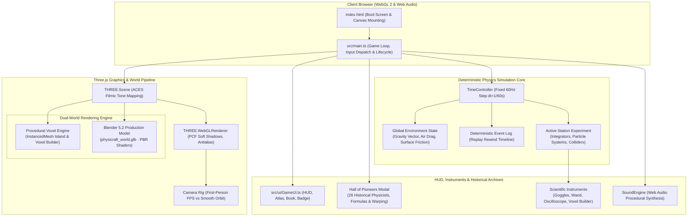
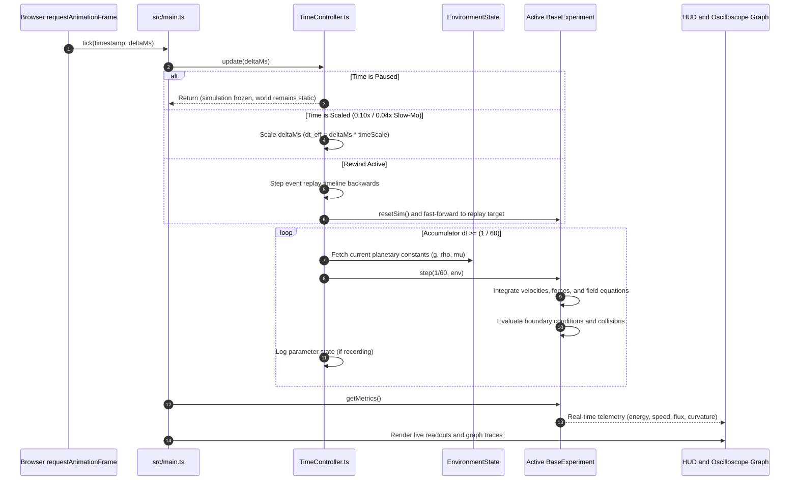
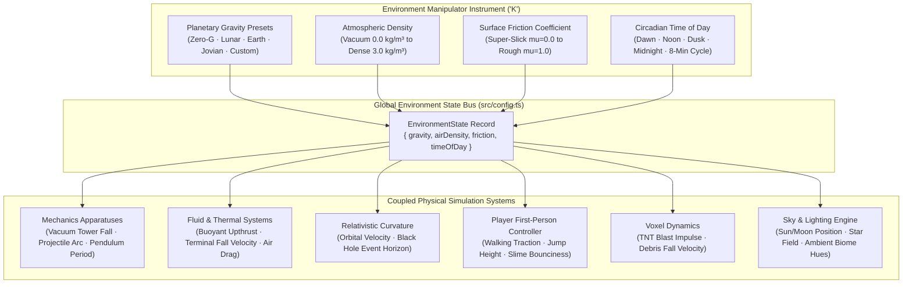
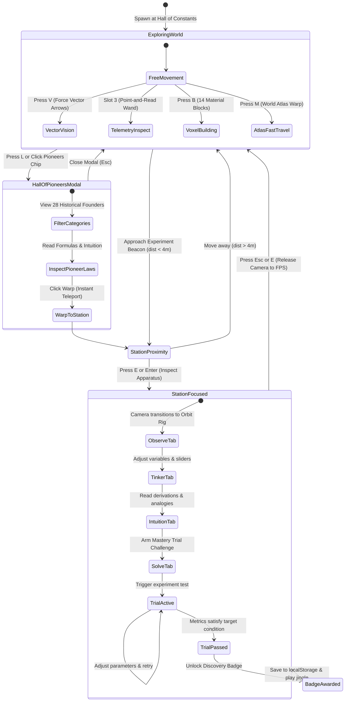
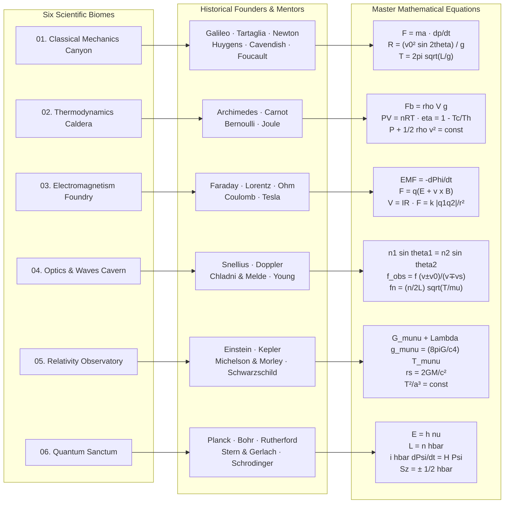

<p align="center">
  
</p>

<h1 align="center">Physicraft</h1>

<p align="center">
  <strong>The Grand Physics Sandbox · An Interactive 3D Field Laboratory</strong><br />
  A first-person physical universe where fundamental laws, historical experiments, and mathematical equations are things you can walk up to, inspect, stress-test, and rebuild.
</p>

<p align="center">
  
  
  
  
  
  
  
</p>

<p align="center">
  <a href="#overview">Overview</a> ·
  <a href="#architecture-and-system-flow">Architecture Flow</a> ·
  <a href="#simulation-loop-and-time-dilation">Simulation Engine</a> ·
  <a href="#player-and-station-lifecycle">State Machine</a> ·
  <a href="#the-six-biomes-and-28-pioneers">Biomes & Pioneers</a> ·
  <a href="#instruments-and-toolbelt">Instruments</a> ·
  <a href="#blender-3d-pipeline">Blender 3D</a> ·
  <a href="#controls">Controls</a> ·
  <a href="#quick-start">Quick Start</a> ·
  <a href="#project-structure">Directory Map</a>
</p>

---

## Overview

**Physicraft** is a browser-based, first-person 3D physics playground set on a floating celestial island. Ringing the central **Hall of Constants**, six distinct biomes house interactive apparatuses simulating mechanics, thermodynamics, electromagnetism, wave optics, special and general relativity, and quantum mechanics.

Unlike static videos or textbook diagrams, every apparatus in Physicraft is a **live, continuous mathematical simulation** computed at a deterministic 60 Hz tick rate. Change gravity, air density, or surface friction in the global Environment Manipulator, and every single experiment recalculates its dynamics in real time.

```
       [ 01. OBSERVE ] ──> Guided physical demonstration with live narrated cues
              │
       [ 02. TINKER  ] ──> Real-time parameter tweaking via dynamic UI controls
              │
       [ 03. INTUIT  ] ──> Mathematical derivation, physical analogy & misconception guide
              │
       [ 04. SOLVE   ] ──> Hands-on Mastery Trial with verified target condition & badge award
```

---

## Architecture and System Flow

The application bridges a **Three.js** WebGL 2 rendering engine with a deterministic 60 Hz physics pipeline, client-side procedural Web Audio synthesis, and a responsive HUD and museum archive.



---

## Simulation Loop and Time-Dilation

Physics calculations are strictly decoupled from rendering framerates. While rendering runs smoothly at the display's native refresh rate (60–144+ FPS via `requestAnimationFrame`), the physical simulation updates on an accumulator-driven **fixed time-step ($\Delta t = \frac{1}{60}\text{ s}$)**.



### Deterministic Zero-Snapshot Rewind
Instead of saving expensive memory snapshots of the entire 3D world every frame, the `TimeController` maintains an event-ordered timeline of user inputs and environment mutations. To rewind:
1. The apparatus is reset to initial conditions ($t = 0$).
2. The simulation rapidly re-integrates the logged event stream up to target timestamp $t_{\text{target}}$.
3. Trajectories unwind with zero storage overhead and bit-perfect physical determinism.

---

## Global Environment Overrides

Every apparatus in Physicraft shares a single reactive environment bus (`EnvironmentState` in [`src/config.ts`](file:///home/mrinall-samal/Project-v2/games/src/config.ts)). Modifying a variable in the **Environment Manipulator** (`K`) immediately propagates to all mechanical, fluid, orbital, and player systems:



---

## Player and Station Lifecycle

The player seamlessly transitions between open-world first-person exploration, scientific telemetry inspection, and focused apparatus experimentation:



---

## The Six Biomes and 28 Pioneers

The island contains **6 themed biomes**, each honoring foundational mentors and master equations across the history of physics:



### Master Experiment & Pioneer Directory

| Biome | Pioneer | Lifespan | Master Discovery | Governing Equation | Station Apparatus |
|---|---|---|---|---|---|
| **Mechanics** | Galileo Galilei | 1564–1642 | Universal Free Fall & Kinematics | $d = \frac{1}{2}gt^2, \quad v = gt$ | Vacuum Drop Tower |
| **Mechanics** | Niccolò Tartaglia | 1499–1557 | Ballistic Projectile Dynamics | $R = \frac{v_0^2 \sin 2\theta}{g}$ | Artillery Trajectory Range |
| **Mechanics** | Sir Isaac Newton | 1643–1727 | Laws of Motion & Momentum | $F = ma = \frac{dp}{dt}, \quad \sum p_i = \sum p_f$ | Collision Track |
| **Mechanics** | Christiaan Huygens | 1629–1695 | Simple Harmonic Motion | $T = 2\pi\sqrt{\frac{L}{g}}$ | Isochronous Pendulum Clock |
| **Mechanics** | Henry Cavendish | 1731–1810 | Universal Gravitational Constant $G$ | $F = G \frac{m_1 m_2}{r^2}$ | Torsion Balance |
| **Mechanics** | Léon Foucault | 1819–1868 | Earth Rotation & Coriolis Precession | $\omega_{\text{prec}} = \Omega_{\text{Earth}} \sin\phi$ | Precession Arena |
| **Thermodynamics** | Archimedes | 287–212 BC | Law of Buoyant Upthrust | $F_b = \rho V g = \Delta m \cdot g$ | Hydrostatic Displacement Basin |
| **Thermodynamics** | Sadi Carnot | 1796–1832 | Carnot Cycle & Thermodynamic Efficiency | $\eta_{\max} = 1 - \frac{T_C}{T_H}$ | Gas Piston Chamber |
| **Thermodynamics** | Daniel Bernoulli | 1700–1782 | Hydrodynamic Energy Conservation | $P + \frac{1}{2}\rho v^2 + \rho gh = \text{const}$ | Venturi Wind Tunnel |
| **Thermodynamics** | James Prescott Joule | 1818–1889 | Mechanical Equivalent of Heat | $W = mgh = J \cdot Q$ | Calorimeter Chamber |
| **Electromagnetism**| Michael Faraday | 1791–1867 | Electromagnetic Induction | $\mathcal{E} = -\frac{d\Phi_B}{dt}$ | AC Induction Generator |
| **Electromagnetism**| Hendrik Lorentz | 1853–1928 | Lorentz Magnetic Deflection | $\mathbf{F} = q(\mathbf{E} + \mathbf{v} \times \mathbf{B})$ | Particle Cyclotron Accelerator |
| **Electromagnetism**| Georg Simon Ohm | 1789–1854 | Electrical Conduction | $V = I \cdot R, \quad P = I^2 R$ | Resistive Circuit River |
| **Electromagnetism**| Charles de Coulomb | 1736–1806 | Electrostatic Inverse-Square Force | $F_e = k_e \frac{\vert q_1 q_2 \vert}{r^2}$ | Torsion Charge Rig |
| **Electromagnetism**| Nikola Tesla | 1856–1943 | High-Voltage Resonant Transformation | $f_0 = \frac{1}{2\pi\sqrt{L_2 C_2}}, \quad V_{\text{top}} = Q \cdot V_{\text{in}}$ | Resonant Lightning Tower |
| **Optics & Waves** | Willebrord Snellius | 1580–1626 | Law of Refraction & Wave Speed | $n_1 \sin\theta_1 = n_2 \sin\theta_2$ | Laser Prism Labyrinth |
| **Optics & Waves** | Christian Doppler | 1803–1853 | Doppler Frequency Shift | $f' = f \left(\frac{v \pm v_0}{v \mp v_s}\right)$ | Relativistic Doppler Speedway |
| **Optics & Waves** | Chladni & Melde | 1756–1827 / 1832–1901 | Standing Waves & Harmonic Resonance | $f_n = \frac{n}{2L}\sqrt{\frac{T}{\mu}}$ | Resonant String Bridge |
| **Optics & Waves** | Thomas Young | 1773–1829 | Wave Interference & Fringe Geometry | $d \sin\theta = m\lambda, \quad y_{\text{fringe}} = \frac{L\lambda}{d}$ | Ripple Tank Interference |
| **Relativity** | Albert Einstein | 1879–1955 | General Relativity & $E = mc^2$ | $G_{\mu\nu} + \Lambda g_{\mu\nu} = \frac{8\pi G}{c^4} T_{\mu\nu}$ | Spacetime Curvature Grid |
| **Relativity** | Johannes Kepler | 1571–1630 | Planetary Orbital Geometry | $\frac{T^2}{a^3} = \frac{4\pi^2}{G(M+m)}$ | Celestial Kepler Orbit Rig |
| **Relativity** | Michelson & Morley | 1852–1931 / 1838–1923 | Constancy of $c$ (Null Aether Drift) | $c = \text{const}, \quad \Delta N = 0.00$ | Interferometer Rail |
| **Relativity** | Karl Schwarzschild | 1873–1916 | Black Holes & Gravitational Lensing | $r_s = \frac{2GM}{c^2}, \quad r_{\text{ph}} = 1.5 r_s$ | Event Horizon Singularity |
| **Quantum** | Max Planck | 1858–1947 | Energy Quanta & Planck Constant | $E = h\nu = \hbar\omega$ | Blackbody Radiant Vault |
| **Quantum** | Niels Bohr | 1885–1962 | Quantized Angular Momentum | $L = n\hbar, \quad E_n = -\frac{13.6\text{ eV}}{n^2}$ | Atomic Shell Orbit Chamber |
| **Quantum** | Ernest Rutherford | 1871–1937 | Atomic Nucleus & Alpha Scattering | $\frac{d\sigma}{d\Omega} \propto \frac{1}{\sin^4(\theta/2)}$ | Gold Foil Alpha Chamber |
| **Quantum** | Stern & Gerlach | 1888–1969 / 1889–1979 | Electron Spin & Spatial Quantization | $S_z = \pm \frac{1}{2}\hbar, \quad F_z = \mu_z \frac{\partial B_z}{\partial z}$ | Molecular Beam Splitter |
| **Quantum** | Erwin Schrödinger | 1887–1961 | Quantum Wave Mechanics | $i\hbar \frac{\partial\Psi}{\partial t} = \hat{H}\Psi = \left[-\frac{\hbar^2}{2m}\nabla^2 + V\right]\Psi$ | Wave Probability Cloud |

---

## Hall of Pioneers Museum Archive

Accessible anytime by pressing <kbd>L</kbd> or clicking the **🏛️ PIONEERS** HUD button:

- **Authentic Likenesses**: High-resolution, historically verified portraits for all 28 founders (including Galileo, Newton, Tartaglia, Chladni, Faraday, Tesla, and Einstein).
- **Museum-Grade Ambient Framing**: Responsive portrait containers featuring non-destructive aspect-ratio containment (`object-fit: contain`) with dynamic blurred ambient backdrop lighting. Every face is fully visible with zero cropping.
- **Master Formulas & Intuition Summaries**: Instant theoretical summaries, mathematical equations, and historical significance for each breakthrough.
- **One-Click Instant Warping**: Click the **⚡ WARP** button on any pioneer card to teleport your first-person avatar directly in front of that apparatus in the 3D world.

---

## Instruments and Toolbelt

| Slot | Instrument | Key | Capabilities |
|---|---|---|---|
| **1** | **Vector Vision Goggles** | <kbd>V</kbd> | Live 3D vector overlays: decomposed velocity (cyan), acceleration (green), gravity (orange), normal force (yellow), and surface friction (red). |
| **2** | **Time-Dilation Controller** | <kbd>P</kbd> / <kbd>T</kbd> / <kbd>F</kbd> / <kbd>R</kbd> | Pause simulation (<kbd>P</kbd>), cycle slow motion 0.10× and 0.04× (<kbd>T</kbd>), advance one frame (<kbd>F</kbd>), or run event-replay rewind (<kbd>R</kbd>). |
| **3** | **Telemetry Inspector Wand** | <kbd>3</kbd> | Aim at any moving body to read velocity components, kinetic/potential energy, acceleration, mass, and trajectory curvature. |
| **4** | **Environment Manipulator** | <kbd>K</kbd> | Global controls for planetary gravity (Earth, Moon, Jupiter, Zero-G), atmospheric drag, surface friction, and circadian day/night time. |
| **5** | **Graph Spawner Oscilloscope** | <kbd>G</kbd> | Deploys a floating real-time oscilloscope that charts position, velocity, energy, or field strength over time. |
| **6** | **Creative Voxel Builder** | <kbd>B</kbd> | 14 physical material block types (stone, bouncy slime, glowstone, explosive TNT with chain-reaction physics, glass). |
| **HUD** | **Blender 3D Fidelity Toggle** | `HUD` | Real-time toggle between the lightweight voxel engine and the 32 MB production Blender 5.2 master world. |

---

## Blender 3D Pipeline

The world is authored in **Blender 5.2** and exported as an optimized binary GLTF:

1. **Master Blender File**: [`Physicraft_World.blend`](file:///home/mrinall-samal/Project-v2/games/Physicraft_World.blend) (11 MB) contains the complete master scene:
   - All 28 apparatus installations with smoothed geometry (Subdivision Surface + weighted normals).
   - High-resolution PBR materials (Principled BSDF) with micro-displacement stone bump maps, brushed brass, dielectric transmission glass, and volumetric neon emission.
   - Theorist Explorer character with physical theorist cloak and copper-banded observation goggles.
2. **Production Web GLB**: [`public/models/physicraft_world.glb`](file:///home/mrinall-samal/Project-v2/games/public/models/physicraft_world.glb) (32 MB):
   - Loaded asynchronously by Three.js `GLTFLoader` in [`src/world/World.ts`](file:///home/mrinall-samal/Project-v2/games/src/world/World.ts).
   - PCF soft shadows, physical roughness/metalness parameters, and material transmission support.

---

## Controls

### Field Exploration (First-Person)
| Input | Action |
|---|---|
| <kbd>W</kbd> <kbd>A</kbd> <kbd>S</kbd> <kbd>D</kbd> | Walk / Strafe |
| <kbd>Shift</kbd> | Sprint |
| <kbd>Space</kbd> | Jump |
| Mouse Move | Look around (Pointer Lock) |
| Left Click | Capture mouse / resume play |
| <kbd>E</kbd> or <kbd>Enter</kbd> | Inspect nearest experiment apparatus |
| <kbd>Esc</kbd> | Close open modal / release mouse lock |

### Global HUD & Fast Travel
| Input | Action |
|---|---|
| <kbd>L</kbd> | Open **Hall of Pioneers & Master Laws** museum archive |
| <kbd>M</kbd> | Open **World Atlas** & fast-travel map |
| <kbd>H</kbd> | Open **Field Manual** & guides |
| <kbd>N</kbd> | Cycle Day / Night sky cycle |
| <kbd>I</kbd> | Open **Creative Voxel Inventory** |

### Inside an Experiment Station
| Control | Action |
|---|---|
| **Observe Tab** | Run the automated, time-coded physics demonstration |
| **Tinker Tab** | Adjust live mathematical parameters and variables |
| **Intuition Tab** | Read equations, analogies, and common misconceptions |
| **Solve Tab** | Arm the Mastery Trial and attempt the target challenge |
| Left Click + Drag | Orbit camera freely around the apparatus |
| Mouse Wheel | Zoom camera in / out |
| <kbd>E</kbd> / <kbd>Esc</kbd> | Exit station back to first-person walking |

---

## Quick Start

### Requirements
- **Node.js** `^20.19.0` or `>=22.12.0` (required by Vite 8)
- **npm** 10+
- Modern desktop browser with **WebGL 2** support (Chrome, Edge, Firefox, Safari, Brave)

### Run Locally
```bash
# 1. Clone repository
git clone https://github.com/MrinallSamal-byte/physicraft.git
cd physicraft

# 2. Install dependencies
npm install

# 3. Start development server
npm run dev
```

Open **http://localhost:5173** in your browser. Click **ENTER THE SANDBOX**, click once more to engage Pointer Lock, and begin exploring.

### Build for Production
```bash
# Type-check and create optimized bundle in dist/
npm run build

# Preview production build locally
npm run preview
```

---

## Project Structure

```text
.
├── Physicraft_World.blend        # Master Blender 5.2 production 3D scene (11 MB)
├── public/
│   ├── models/
│   │   └── physicraft_world.glb  # Optimized binary GLTF 3D universe (32 MB)
│   └── portraits/                # 28 authentic historical portraits & plaques
├── src/
│   ├── main.ts                   # Game loop, HUD wiring, keyboard inputs, setup
│   ├── config.ts                 # Biome coords, environment state, planetary presets
│   ├── style.css                 # Complete UI design system, museum framing, HUD
│   ├── audio/
│   │   └── SoundEngine.ts        # Procedural Web Audio synthesizer (no audio files)
│   ├── core/
│   │   └── utils.ts              # Math utilities, seeded PRNG, texture helpers
│   ├── data/
│   │   └── pioneers.ts           # 28 Pioneers, master equations, warp coordinates
│   ├── game/
│   │   ├── TimeController.ts     # Fixed 60Hz loop, slow-motion, deterministic rewind
│   │   ├── TelemetryInspector.ts # Raycast wand physics inspector
│   │   ├── VectorOverlay.ts      # 3D force & velocity arrow vector overlay
│   │   ├── GraphBoard.ts         # In-world oscilloscope charting
│   │   └── VoxelBuilder.ts       # Creative block building & TNT chain explosions
│   ├── player/
│   │   ├── PlayerController.ts   # First-person kinematics, jumping, slime bounce
│   │   ├── Input.ts              # Pointer lock, keybinds, and action mapping
│   │   └── Viewmodel.ts          # Animated first-person scientific tools
│   ├── stations/
│   │   ├── BaseExperiment.ts     # Base class for all physics apparatuses
│   │   ├── registry.ts           # 28 Experiment registrations and proximity logic
│   │   ├── intuition.ts          # Deep physical intuitions and derivations
│   │   └── experiments/          # Specialized simulation logic per biome:
│   │       ├── classical.ts      # Free fall, projectiles, collisions, pendulums
│   │       ├── thermo.ts         # Buoyancy, gas pistons, Bernoulli flow
│   │       ├── electro.ts        # Ohm river, Faraday generator, Lorentz cyclotron
│   │       ├── optics.ts         # Snell labyrinth, Doppler rail, Chladni waves
│   │       ├── relativity.ts     # Spacetime curvature, twin paradox, black holes
│   │       └── quantum.ts        # Double-slit, photoelectric effect, atomic orbitals
│   ├── ui/
│   │   ├── GameUI.ts             # HUD, Hall of Pioneers modal, Atlas, Badges
│   │   └── icons.ts              # Procedural SVG iconography
│   └── world/
│       ├── World.ts              # Three.js world manager & GLTF loader
│       ├── textures.ts           # 16x16 pixel-art voxel material textures
│       ├── voxel.ts              # Instanced voxel mesh batching
│       └── labels.ts             # High-DPI canvas text banners in 3D
├── docs/                         # Documentation images and screenshots
├── vite.config.ts                # Vite build and asset pipeline configuration
└── tsconfig.json                 # Strict TypeScript compiler options
```

---

## Developer Console API

During development (`npm run dev`), Physicraft exposes a global debug hook `window.__sandbox` in the browser console:

```javascript
__sandbox.focus('double-slit');          // Focus camera and UI on a specific station
__sandbox.travel('spacetime');           // Teleport player avatar to station beacon
__sandbox.env({ gravity: 1.62 });        // Set lunar gravity (1.62 m/s²)
__sandbox.env({ airDensity: 0.0 });      // Set vacuum conditions
__sandbox.setTime(0.5);                  // Set sky to high noon
__sandbox.arm();                         // Arm current experiment mastery trial
__sandbox.observe();                     // Trigger guided automated demonstration
__sandbox.selectBlock('tnt');            // Equip TNT in creative voxel builder
__sandbox.state();                       // Print active telemetry, environment, and player state
```

---

## Contributing

1. Fork the repository and create a feature branch (`git checkout -b feature/new-apparatus`).
2. Run `npm install` and verify the dev server runs with `npm run dev`.
3. Ensure strict TypeScript compilation passes with zero errors: `npm run build`.
4. Submit a Pull Request with a clear description of the physical model and equations implemented.

---

## License

All rights reserved. See repository notice for licensing inquiries.

<p align="center"><sub>Calibrating the constants of a small universe.</sub></p>
