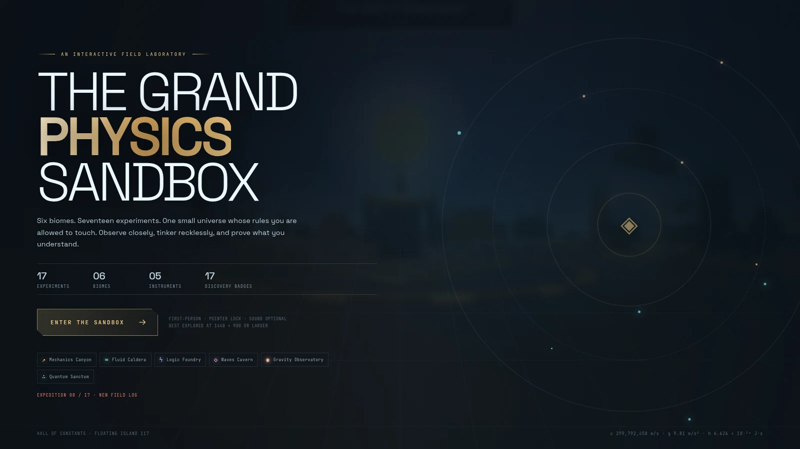
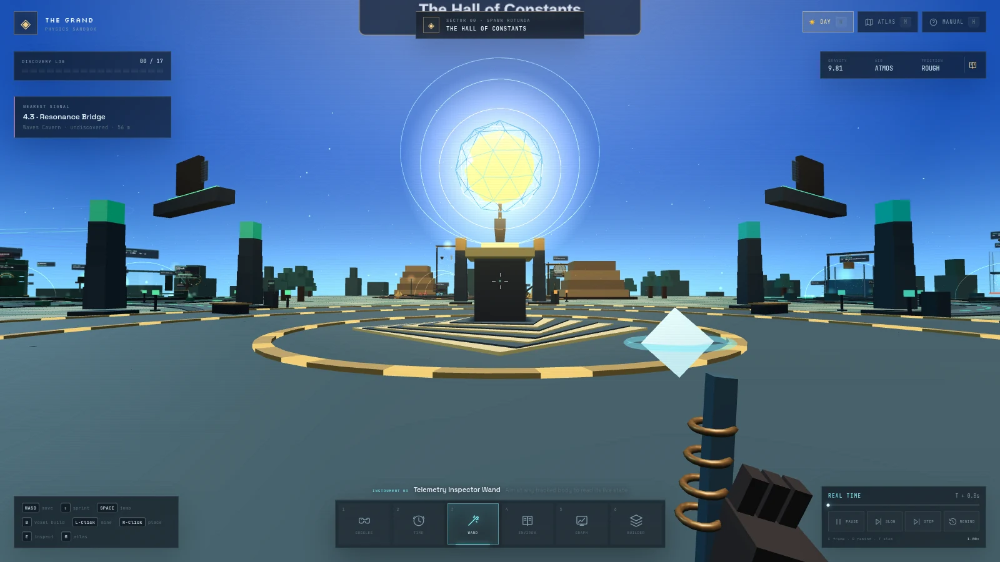
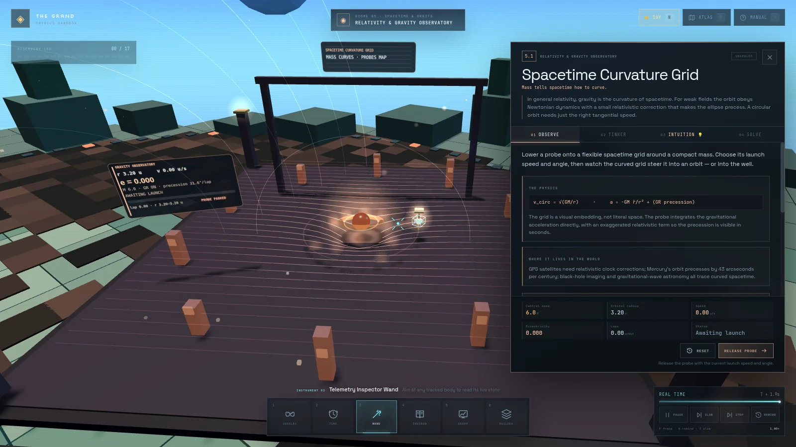

<p align="center">
  
</p>

<h1 align="center">Physicraft</h1>

<p align="center">
  <strong>The Grand Physics Sandbox</strong><br />
  A first-person voxel laboratory where physics is something you can walk up to, break, and rebuild.
</p>

<p align="center">
  
  
  
  
  
</p>

<p align="center">
  <a href="#overview">Overview</a> ·
  <a href="#screenshots">Screenshots</a> ·
  <a href="#the-six-biomes">Biomes</a> ·
  <a href="#the-seventeen-experiments">Experiments</a> ·
  <a href="#controls">Controls</a> ·
  <a href="#quick-start">Quick start</a> ·
  <a href="#project-structure">Architecture</a>
</p>

---

## Overview

**Physicraft** is a browser-based 3D physics playground set on a floating island. Six themed biomes ring a central **Hall of Constants**, and each one holds a hand-built, interactive apparatus you can inspect, tune, and stress-test.

There are **17 experiments**, **6 biomes**, **6 scientific instruments**, and **17 discovery badges**. Every experiment follows the same loop:

> **OBSERVE** a guided demonstration → **TINKER** with the variables → **INTUITION** behind the equations → **SOLVE** a mastery trial and seal a badge.

The physics is not a video of physics. Every apparatus is a live simulation driven by the same global environment: change gravity, air density, or friction in the Environment Manipulator and *every* experiment must reconsider its answer. Freeze time, slow it to 10%, advance frame by frame, or rewind and watch a trajectory unwind.

Everything runs client-side. No backend, no accounts, no external art or audio assets — the island, textures, labels, and sound effects are all generated procedurally. The only external files are three web fonts.

The repo is named **Physicraft**; the in-game world is **The Grand Physics Sandbox**.

---

## Screenshots

<p align="center">
  
  
</p>

<p align="center">
  <em>Left: the Hall of Constants at spawn. Right: inspecting the Spacetime Curvature Grid.</em>
</p>

---

## Highlights

- **17 interactive experiments** across mechanics, thermodynamics, electromagnetism, optics, relativity, and quantum physics.
- **A real simulation, not a slideshow** — closed-form and integrated physics, fixed 1/60 s time step, live parameter changes.
- **Global environment overrides** — gravity from 0 to 24.79 m/s², vacuum or atmosphere, frictionless or rough surfaces, all shared by every apparatus.
- **Deterministic time control** — pause, 0.10× or 0.04× slow motion, single-frame step, and rewind via event replay.
- **Six scientific instruments** — vector goggles, time controller, telemetry wand, environment book, a deployable graph board, and a creative voxel builder.
- **A voxel sandbox inside the sandbox** — 14 block types with real material properties: glowstone lights, bouncy slime, and TNT with cascading chain reactions.
- **Discovery badges** that persist in `localStorage`, a world atlas with fast travel, and a guided field manual.
- **Procedural everything** — 16×16 pixel-art textures, world labels, island geometry, and 16-bit-style sound effects synthesized with the Web Audio API.
- **Day and night** — an 8-minute sky cycle, dawn/noon/dusk/midnight presets, moving sun and moon, stars, and biome lighting.

---

## The six biomes

| # | Biome | Discipline | Mentors | Experiments |
|---|-------|------------|---------|-------------|
| 01 | **Classical Mechanics Canyon** | Motion, force & conservation | Galileo · Newton | 4 |
| 02 | **Thermodynamics & Fluid Caldera** | Heat, pressure & flow | Archimedes · Carnot | 3 |
| 03 | **Electromagnetism & Logic Foundry** | Charge, fields & induction | Faraday · Maxwell | 3 |
| 04 | **Optics, Waves & Acoustics Cavern** | Light, sound & resonance | Huygens · Snell | 3 |
| 05 | **Relativity & Gravity Observatory** | Spacetime & orbits | Einstein · Kepler | 2 |
| 06 | **Quantum & Modern Physics Sanctum** | Probability & quanta | Planck · Bohr · Young | 2 |

Each biome has its own palette, skyline, architecture, ambient light, and a question that frames its experiments — for example, the Mechanics Canyon asks *"How does motion unfold when the rules are counted?"*

---

## The seventeen experiments

| # | Biome | Experiment | Core idea | Badge |
|---|-------|------------|-----------|-------|
| 1.1 | Mechanics | **Galileo's Vacuum Tower** | Free fall, inertia, and air drag | Equal Fall |
| 1.2 | Mechanics | **Projectile Artillery Range** | Independent horizontal and vertical motion | Parabola Perfect |
| 1.3 | Mechanics | **Momentum & Collision Track** | Conservation of momentum; elastic vs. inelastic | Momentum Keeper |
| 1.4 | Mechanics | **Simple Harmonic Pendulum Clocktower** | Period depends on length and gravity, not mass | Metronome |
| 2.1 | Fluids | **Archimedes' Displacement Basin** | Buoyancy and average density | Neutral Buoyancy |
| 2.2 | Fluids | **Ideal Gas Piston Chamber** | `PV = nRT`; pressure, volume, temperature | Pressure Point |
| 2.3 | Fluids | **Bernoulli's Wind Tunnel** | Faster flow, lower pressure, and lift | Lift-Off |
| 3.1 | Electro | **Ohm's Law Interactive River** | Current, voltage, resistance, power | Circuit Whisperer |
| 3.2 | Electro | **Faraday's Induction Generator** | Changing flux induces an EMF | Flux Capacitor |
| 3.3 | Electro | **Lorentz Force Particle Accelerator** | `F = qv × B` and circular motion | Right-Hand Rule |
| 4.1 | Optics | **Snell's Laser Labyrinth** | Refraction, total internal reflection | Critical Angle |
| 4.2 | Optics | **Doppler Speedway** | Observed frequency depends on relative motion | Redshift Rider |
| 4.3 | Optics | **Standing-Wave Bridge** | Resonance, harmonics, and wave speed | Resonance Weaver |
| 5.1 | Relativity | **Spacetime Curvature Grid** | Orbits as motion in curved spacetime | Orbit Cartographer |
| 5.2 | Relativity | **Twin Paradox Rail** | Time dilation and proper time | Proper Time |
| 6.1 | Quantum | **Double-Slit Arena** | Interference and wave–particle duality | Fringe Weaver |
| 6.2 | Quantum | **Photoelectric Vault** | Photon energy, work function, stopping potential | Quantum Gatekeeper |

Each experiment ships with:

- **Guided observation** with time-coded narration cues.
- **Live parameters** (ranges, selects, toggles) that update the apparatus immediately.
- **Real readouts** — position, velocity, energy, pressure, EMF, fringe spacing, and more.
- **An Intuition guide** — a big question, an everyday analogy, the physical mechanism, an equation breakdown, things to try, and common misconceptions.
- **A mastery trial** with a specific target, a hint, and a success condition, rewarded with a discovery badge.

---

## Instruments

| Slot | Instrument | Key | What it does |
|------|------------|-----|--------------|
| 1 | **Vector Vision Goggles** | `V` | Overlays velocity, acceleration, gravity, normal, and friction arrows on tracked bodies. |
| 2 | **Time-Dilation Controller** | `P` / `T` / `F` / `R` | Pause, cycle 0.10× and 0.04× slow motion, advance one 1/60 s frame, or rewind the session. |
| 3 | **Telemetry Inspector Wand** | `3` | Aim at a moving body to read speed, acceleration, mass, momentum, kinetic and potential energy. |
| 4 | **Environment Manipulator** | `K` | Rewrites gravity, air density, surface friction, and sky time for the whole island. |
| 5 | **Graph Spawner Block** | `G` | Deploys a floating oscilloscope that charts position, speed, and energy in real time. |
| 6 | **Voxel Builder** | `B` | Creative building and mining, with physical materials, dynamic colliders, and TNT. |

The HUD also includes a **world atlas** (`M`) with fast travel to any beacon, a **field manual** (`H`), a **creative inventory** (`I`), and a **day/night toggle** (`N`).

---

## Controls

### On foot

| Input | Action |
|-------|--------|
| `W` `A` `S` `D` / arrow keys | Walk |
| `Shift` | Sprint |
| `Space` | Jump |
| Mouse | Look |
| Click | Capture the mouse / resume exploring |
| `E` or `Enter` | Inspect the nearest apparatus |
| `Esc` | Close the current panel, or release the mouse |

### Instruments and panels

| Input | Action |
|-------|--------|
| `1` … `6` | Select goggles, time controller, wand, environment book, graph, builder |
| `V` | Toggle Vector Vision |
| `P` | Pause / resume apparatus time |
| `T` | Cycle slow motion: 0.10×, then 0.04×, then real time |
| `F` | Advance a single 1/60 s frame |
| `R` | Start / stop rewinding the current session |
| `G` | Deploy or retract the graph board |
| `K` | Open the Environment Manipulator |
| `B` | Toggle the voxel builder |
| `I` | Open the creative inventory |
| `M` | Open the world atlas |
| `H` | Open the field manual |
| `N` | Toggle day / night |

### Inside a station

| Input | Action |
|-------|--------|
| `Observe` tab | Run the guided demonstration |
| `Tinker` tab | Adjust the apparatus parameters |
| `Intuition` tab | Read the deeper explanation and misconceptions |
| `Solve` tab | Arm the mastery trial and attempt the target |
| Left-drag | Orbit the camera around the apparatus |
| Mouse wheel | Adjust framing distance |
| `E` / `Esc` | Return to the field |

### Voxel builder

| Input | Action |
|-------|--------|
| Left-click | Mine a block |
| Right-click | Place the selected block |
| Scroll wheel | Cycle the 14 block types |
| `I` / `E` | Open the creative inventory and material inspector |
| `B` | Exit the builder |

---

## Quick start

### Requirements

- **Node.js** `^20.19.0` or `>=22.12.0` (the engine range required by Vite 8)
- **npm** 10+
- A desktop browser with **WebGL 2** and Pointer Lock support (Chrome, Edge, Firefox, or Safari)

No API keys, environment variables, or backend services are needed.

### Run it locally

```bash
git clone https://github.com/MrinallSamal-byte/physicraft.git
cd physicraft
npm install
npm run dev
```

Open the URL printed by Vite — by default **http://localhost:5173**.

Click **ENTER THE SANDBOX**, then click once more to capture the mouse. Walk the brass paths, press `E` at a glowing beacon, and start with experiment **1.1**.

### Scripts

| Command | What it does |
|---------|--------------|
| `npm run dev` | Start the Vite dev server on `0.0.0.0:5173` with hot reload |
| `npm run build` | Type-check with `tsc --noEmit`, then build a production bundle to `dist/` |
| `npm run preview` | Serve the production build locally |

---

## Project structure

```text
.
├── index.html                  # Boot screen, favicon, metadata
├── src/
│   ├── main.ts                 # Bootstrap, HUD wiring, input bindings, main loop
│   ├── config.ts               # World constants, biomes, station layout, environment presets
│   ├── style.css               # Full HUD, modal, and station-panel design system
│   ├── core/
│   │   └── utils.ts            # Math helpers, seeded RNG, procedural textures
│   ├── world/
│   │   ├── World.ts            # Floating island, biome terrain, sky, sun/moon, lighting
│   │   ├── voxel.ts            # Voxel/box helpers and instanced-mesh batching
│   │   ├── textures.ts         # 16×16 pixel-art block textures + material metadata
│   │   └── labels.ts           # Canvas-rendered world labels and readouts
│   ├── player/
│   │   ├── PlayerController.ts # First-person movement, collision, jump, slime bounce
│   │   ├── Input.ts            # Keyboard/mouse actions and pointer lock
│   │   └── Viewmodel.ts        # Animated first-person instruments
│   ├── game/
│   │   ├── TimeController.ts   # Pause, slow motion, frame step, deterministic rewind
│   │   ├── TelemetryInspector.ts
│   │   ├── VectorOverlay.ts    # Force/velocity arrow rendering
│   │   ├── GraphBoard.ts       # Floating oscilloscope
│   │   └── VoxelBuilder.ts     # Mining, placing, debris, TNT chain reactions
│   ├── stations/
│   │   ├── BaseExperiment.ts   # Shared experiment lifecycle and scene helpers
│   │   ├── registry.ts         # All 17 stations, markers, badges, proximity logic
│   │   ├── intuition.ts        # Written intuition guides for every experiment
│   │   └── experiments/        # classical, thermo, electro, optics, relativity, quantum
│   ├── ui/
│   │   └── GameUI.ts           # HUD, atlas, manual, station panel, inventory, badge ceremony
│   └── audio/
│       └── SoundEngine.ts      # Procedural Web Audio sound effects
├── docs/                       # README screenshots
├── vite.config.ts
└── tsconfig.json
```

---

## How it works

**Simulation.** Each experiment extends `Experiment` and implements `buildVisual`, `resetSim`, `step`, `isSolved`, and `getMetrics`. The `TimeController` advances focused experiments on a fixed **1/60 s** step, while the global `EnvironmentState` — gravity, air, friction — is passed into every step. Parameters can change mid-flight.

**Rewind without snapshots.** Rewinding is a deterministic replay, not a stored video. The controller records the initial parameters and environment plus every user action in order. To rewind, it resets the apparatus and rapidly re-simulates the event stream to the requested time. This keeps save data tiny and guarantees the same trajectory every run.

**Environment coupling.** Gravity presets (Zero-G, Lunar, Terrestrial, Jovian, custom), air density (0–3 kg/m³), and friction (μ 0–1) are global fields. The same values drive the pendulum, the gas piston, the projectile, and even the player's jump and slime-block bounce.

**Rendering.** Three.js with ACES Filmic tone mapping and soft shadows. The island is built from instanced voxel boxes, while block textures are generated at runtime as 16×16 canvases with nearest-neighbor filtering for a crisp pixel-art look. Camera framing blends into an orbit rig when you inspect a station.

**Audio.** Every footstep, click, block break, and explosion is synthesized at runtime with the Web Audio API. There are no audio files.

**Persistence.** Only discovery badges are saved, under the `localStorage` key `grand-physics-sandbox-v1`. Placed voxel blocks are session-only. Clearing site data resets progress.

---

## Developer console

In development builds (`npm run dev`), the app exposes `window.__sandbox` for fast manual QA:

```js
__sandbox.focus('double-slit');          // focus a station by id
__sandbox.travel('spacetime');           // teleport to a station
__sandbox.param('projectile', 15);       // change a parameter
__sandbox.arm();                         // arm the current mastery trial
__sandbox.observe();                     // run the guided observation
__sandbox.env({ gravity: 1.62 });        // override the environment
__sandbox.setTime(0);                    // midnight
__sandbox.selectBlock('tnt');
__sandbox.placeAt(4, 3, 8, 'slime');
__sandbox.state();                       // env, focused station, tool, progress, time
__sandbox.stations();                    // all station ids
```

These hooks are compiled out of production builds.

---

## Deployment

`npm run build` produces a fully static site in `dist/` — host it on GitHub Pages, Netlify, Vercel, Cloudflare Pages, or any static file server.

For **GitHub Pages under a project path** (`https://<user>.github.io/physicraft/`), set the base path in `vite.config.ts`:

```ts
export default defineConfig({
  base: '/physicraft/',
  // ...
});
```

For a custom domain or a user/organization site served from the root, leave `base` unset.

---

## Known limits

- **Desktop-first.** Mouse look, pointer lock, and the dense HUD are designed for a keyboard and mouse. Phones and tablets are not currently supported.
- **No automated tests or linting yet.** `npm run build` is the current correctness gate (strict TypeScript, no emit).
- **Session-only builds.** Voxel constructions disappear on refresh; only badges persist.
- **Public repo, no license.** See below before reusing the code.

---

## Contributing

Issues and pull requests are welcome. If you change the simulation or UI:

1. Fork the repo and create a branch.
2. Run `npm install` and `npm run dev`.
3. Verify `npm run build` passes before opening a PR.
4. Keep new experiments inside the existing `Experiment` lifecycle and register them in `src/stations/registry.ts`.
5. Add an intuition guide in `src/stations/intuition.ts` if you add an experiment.

---

## License

No license has been added to this repository yet. Until one is, the code is **all rights reserved** by default, and it should not be reused, redistributed, or hosted as your own without permission.

If you would like to reuse it, open an issue to discuss a license. An **MIT** license would be the natural fit for a project like this.

---

## Acknowledgements

- [Three.js](https://threejs.org/) for the renderer and math.
- [Vite](https://vite.dev/) and [TypeScript](https://www.typescriptlang.org/) for the toolchain.
- [Fontsource](https://fontsource.org/) for Space Grotesk, JetBrains Mono, and Silkscreen.
- The apparatus designs follow the classic demonstrations that make physics click — Galileo's tower, Newton's cradle, Faraday's coil, Young's slits, and the rest.

<p align="center"><sub>Calibrating the constants of a small universe.</sub></p>
